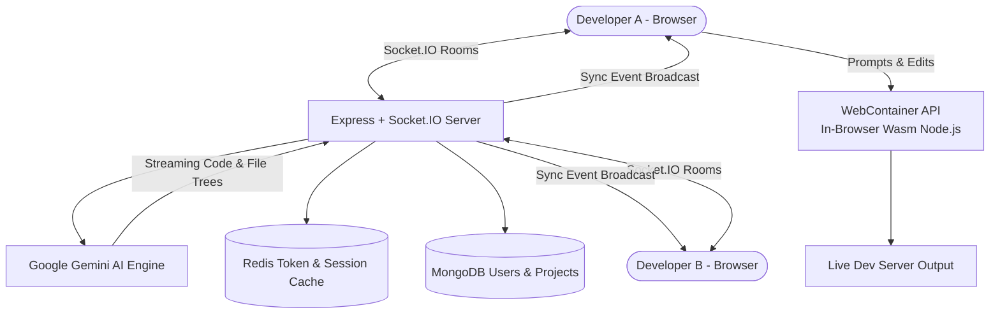

# Full Project Analysis: Multi-Project Chat & AI Collaboration Suite

## 0.1 What the Project Is
The **Multi-Project Chat & AI Collaboration Suite** encompasses two enterprise real-time collaboration applications:
1. **Soen (`soen-main`)**: An intelligent AI-assisted collaborative coding workspace combining Google Gemini AI, real-time multi-user Socket.IO rooms, and in-browser Node.js execution via the WebContainer API.
2. **Chat App (`chat-app-main`)**: An enterprise audio/video and messaging portal powered by Tencent Cloud TRTC Chat UIKit with HMAC cryptographic signature generation.

### Target Personas
1. **Software Engineers & Pair Programmers**: Collaborating in real-time on live code with instant browser execution and zero local environment setup.
2. **Engineering Students & Tutors**: Live code reviews with inline AI explanation and sandbox code execution.
3. **Enterprise Teams**: High-fidelity video calling and rich IM channels.

## 0.2 Real-Time Collaborative Architecture Diagram

## 0.3 Inventory Counts
- **Total Applications**: 2 production systems (`soen-main`, `chat-app-main`).
- **Core Real-Time Protocols**: WebSockets (Socket.IO), WebRTC (TRTC), WebAssembly (WebContainer API).
- **Backend Endpoints**: 12 REST routes and 8 Socket.IO event channels.
- **External AI Providers**: Google Gemini AI API (`gemini-1.5-flash`).
