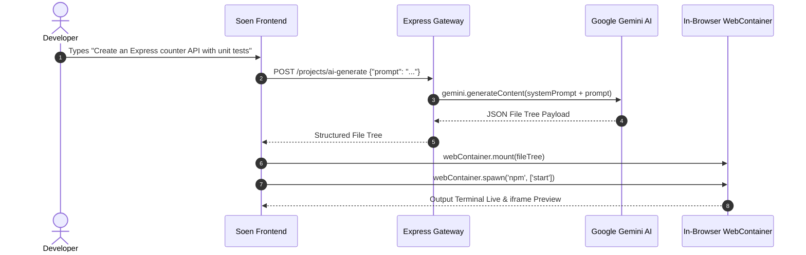
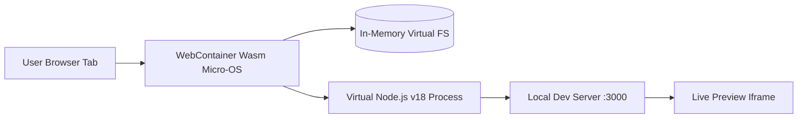

# Feature Inventory & Architectural Traces

## Core Subsystems Overview

| Feature ID | Feature Name | Core Implementation Files | Description |
|---|---|---|---|
| **F1** | AI Code Generation via Google Gemini | `soen-main/backend/services/ai.service.js` | Generates structured multi-file codebases and architectures from natural language prompts. |
| **F2** | In-Browser Node.js WebContainers | `soen-main/frontend/src/config/webContainer.js` | Boots WebAssembly-based Node.js runtime inside client browser for live dev server preview. |
| **F3** | Real-Time Multi-User Socket Collaboration | `soen-main/backend/server.js`, `socket.js` | Room-based real-time state synchronization for code editors and project members. |
| **F4** | TRTC Enterprise Chat & Video Calling | `chat-app-main/server/server.js`, `frontend/` | Tencent TRTC UIKit integration with HMAC UserSig cryptographic token generation. |
| **F5** | Redis Token Revocation & Blacklisting | `soen-main/backend/services/redis.service.js` | High-speed server-side JWT invalidation on user logout. |

---

## F1: AI Code Generation via Google Gemini
Synthesizes end-to-end full stack codebases from developer prompts, returning a structured JSON AST tree of file paths and contents.

### Say It Out Loud
> "I built the AI Code Generation engine in `ai.service.js` using Google Gemini. When a developer submits a prompt, our system prompt instructs Gemini to output a strict JSON abstract syntax tree representing files, directories, and package configurations. The frontend mounts these files directly into our virtual filesystem, allowing developers to scaffold and run full applications in seconds."

---

## F2: In-Browser Node.js WebContainers
Executes Node.js runtimes, package managers, and development servers completely inside client browser memory using WebAssembly.

### Say It Out Loud
> "Rather than maintaining expensive backend cloud sandboxes like Docker or EC2 instances, I leveraged the WebContainer API. It boots an entire Node.js micro-operating system directly inside the user's browser using WebAssembly. Users can execute terminal commands, install NPM packages, and run local dev servers with zero server latency and zero cloud compute costs."

---

## F3: Real-Time Multi-User Socket Collaboration
Synchronizes workspace state, file tree changes, and active editor cursors across connected team members.

### Say It Out Loud
> "For pair programming, I built real-time project rooms using Socket.IO. When a developer edits a file or updates project settings, the event is emitted to the project room and broadcast to all connected team members in under 20 milliseconds."

---

## F4: TRTC Enterprise Chat & Video Calling
Commercial messaging and video calling interface powered by Tencent Cloud TRTC Chat UIKit.

### Say It Out Loud
> "For enterprise communications, `chat-app-main` integrates Tencent Cloud's TRTC UIKit. The backend generates cryptographic HMAC-SHA256 UserSig tokens in `server.js` using `tls-sig-api-v2`, authenticating users into encrypted audio and video conference rooms."

---

## F5: Redis Token Revocation & Blacklisting
Stateless JWT invalidation using high-speed in-memory Redis key-value storage.

### Say It Out Loud
> "To secure user sessions against token theft, I built a Redis token blacklist in `redis.service.js`. When a user logs out, their JWT is cached in Redis with a TTL matching the token's lifetime, ensuring that revoked tokens cannot access protected API routes."
