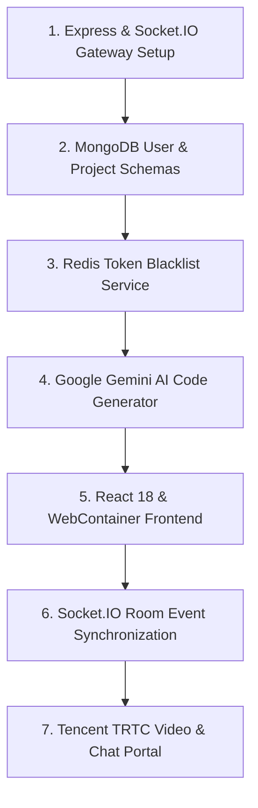

# Build Order: Reconstructing the Collaboration Suite

## Step-by-Step Implementation Sequence

1. **Gateway Server**: Configure Express and Socket.IO in `server.js` with CORS and body parsing.
2. **Database Models**: Create Mongoose schemas for users and project workspaces.
3. **Redis Security**: Implement token blacklist caching with TTLs in `redis.service.js`.
4. **AI Generation Pipeline**: Connect Google Gemini AI SDK with structured JSON prompts.
5. **WebContainer Integration**: Initialize `@webcontainer/api` in the React frontend.
6. **Real-Time Sync**: Wire Socket.IO room events for live editor updates.
7. **TRTC Messaging**: Integrate Tencent Cloud UIKit with HMAC UserSig generation.
