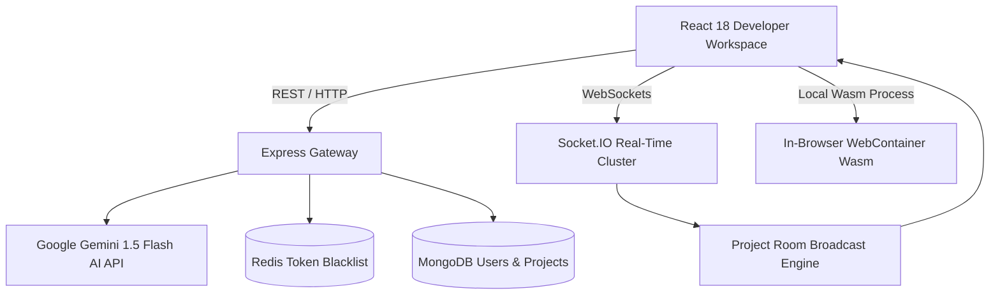

# Architecture & System Design: Collaboration Suite

## System Topology

## WebContainer Virtual Operating System
The WebContainer API executes a localized virtual file system directly within browser memory. Code modifications triggered by the developer or Gemini AI are mounted as virtual directory trees without writing unverified user code to backend servers.
